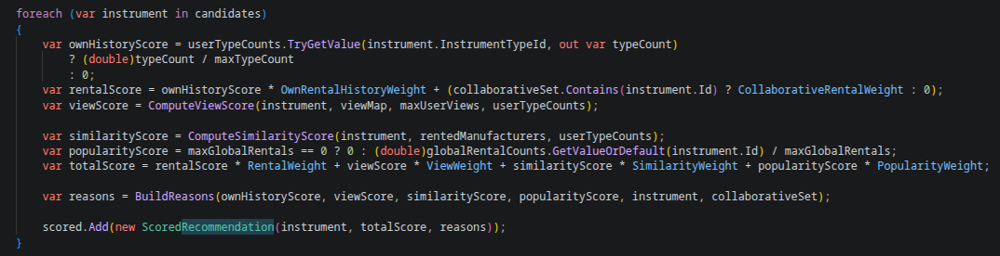
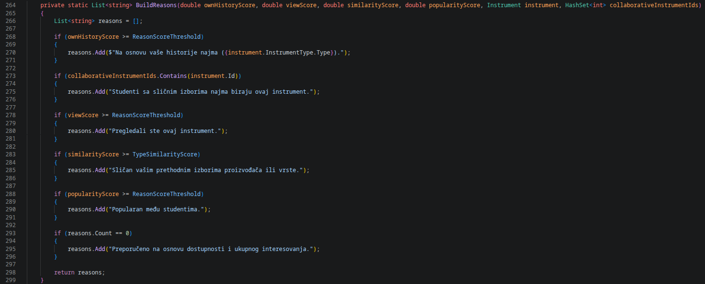
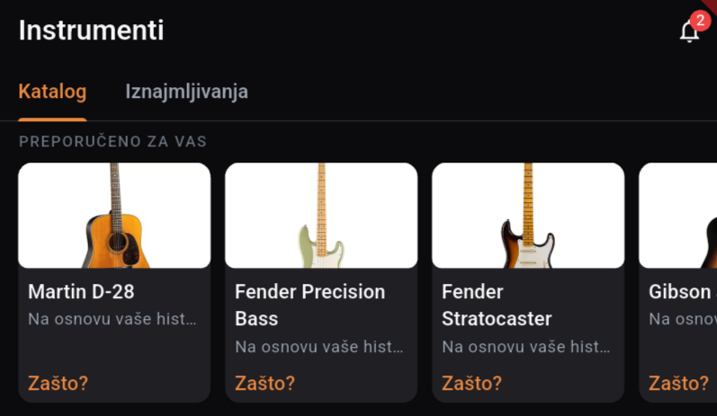
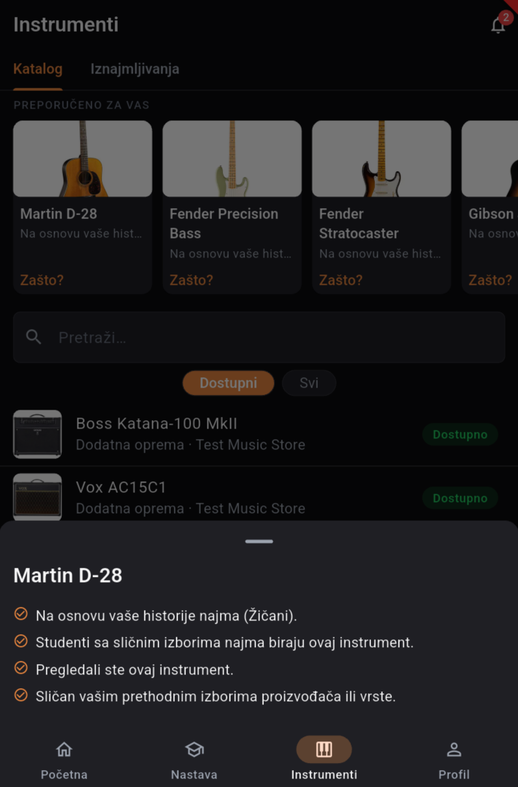

# Dokumentacija recommender sistema

eNote preporučuje studentu instrumente za najam. Preporuke se računaju iz podataka
koje aplikacija stvarno prikuplja: historije najma tog studenta, najmova ostalih
studenata, evidencije pregleda kataloga i ukupnog broja najmova po instrumentu.

## Gdje se nalazi kod

Servis: `eNote/eNote.Application/Features/Rentals/Recommendations/Services/RecommendationService.cs`

Kontroler: `eNote/eNote.API/Controllers/Rentals/InstrumentController.cs`

| Endpoint | Uloga | Šta radi |
|---|---|---|
| `GET /api/v1/student/instruments/recommended?count=5` | Student | Vraća listu preporuka sa skorom i objašnjenjima |
| `POST /api/v1/student/instruments/{id}/view` | Student | Evidentira pregled instrumenta u tabelu `InstrumentView` |

## Kako se računa skor

Ukupni skor je zbir četiri signala sa fiksnim težinama. Konstante su na vrhu
`RecommendationService`.

| Signal | Težina | Odakle dolazi |
|---|---|---|
| Najam | 0.40 | Vrste instrumenata koje je student već najmio, plus instrumenti koje biraju slični studenti |
| Pregledi | 0.30 | `InstrumentView` za tog korisnika, podijeljeno najvećim brojem pregleda među instrumentima koji se mogu preporučiti |
| Sličnost | 0.20 | Proizvođač iz tabele `Manufacturer` kojeg je student već najmio daje 1.0, vrsta koju je već najmio daje 0.6 |
| Popularnost | 0.10 | Broj najmova instrumenta (odobreni, aktivni, završeni i vraćeni prije roka), podijeljen brojem najmova najnajmljenijeg instrumenta koji se može preporučiti |

```
total = najam * 0.40 + pregledi * 0.30 + sličnost * 0.20 + popularnost * 0.10
```

Signal sličnosti poredi `ManufacturerId` instrumenta sa skupom `ManufacturerId` vrijednosti iz historije najma studenta. Naziv proizvođača se ne poredi kao tekst, nego preko stranog ključa prema tabeli `Manufacturer`.

Signal najma se računa kao `najam = vlastita historija * 0.60 + kolaborativni dio * 0.40`.
Vlastita historija je broj najmova te vrste podijeljen brojem najmova najčešće vrste
tog studenta. Kolaborativni dio je 1 za instrument u kolaborativnom skupu, inače 0.

Kolaborativni dio radi u dva koraka u metodi `BuildCollaborativeInstrumentIdsAsync`.
Prvo se nađu studenti koji su najmili bar jedan isti instrument kao trenutni
student. Zatim se uzmu instrumenti koje su ti studenti najmili, a trenutni student
nije. Ti instrumenti ulaze u kandidate i dobijaju puni kolaborativni skor.

Ako je instrument iste vrste koju je student ranije najmio, signal pregleda dobija
najmanje 0.35 (`TypeViewFallbackScore`). Bez toga bi novi instrumenti u poznatoj
vrsti ispadali iz preporuka. Zato pregled nikad ne spušta skor instrumenta.

U preporuke ulaze samo aktivni instrumenti koje student može zatražiti. Izbacuju se
instrumenti sa odobrenim ili aktivnim najmom bilo kojeg studenta i instrumenti na koje
taj student već ima zahtjev na čekanju (`RecommendableInstruments`). Zato svaka
preporuka ima `isAvailable: true`.

## Kandidati za preporuku

Skup kandidata se gradi u metodi `LoadCandidateInstrumentsAsync`, prije računanja
skora. Veličina skupa je `poolSize = max(count * PoolSizePerResult, CandidatePoolSize)`,
dakle 80 za podrazumijevanih pet preporuka. `PoolSizePerResult` je 12.

| Izvor kandidata | Odakle se uzima | Koliko ulazi |
|---|---|---|
| Preferirane vrste | aktivni instrumenti vrsta iz historije najma studenta, po id-u | do `poolSize / 2` |
| Pregledi | `InstrumentView` tog korisnika, po broju pregleda opadajuće pa po id-u | do `poolSize / 4` |
| Kolaborativni | instrumenti studenata sa sličnim izborima najma | svi, po broju najmova među sličnim studentima |
| Popularni | instrumenti sa najviše najmova ukupno | do `poolSize / 2` |

Redoslijed je važan. Identifikatori se spajaju upravo tim redom (preferirane vrste,
pregledi, kolaborativni, popularni), duplikati se uklanjaju i zadržava se prvih
`poolSize`. Sva ograničenja važe samo za instrumente koji se mogu preporučiti, pa
arhivirani ili iznajmljeni instrument ne zauzima mjesto. Prvih `poolSize / 4`
pregledanih instrumenata uvijek ulazi u formulu, jer preferirane vrste i pregledi
zajedno uzimaju najviše 3/4 skupa. Ako kandidata ima manje od traženog broja `count`,
skup se dopunjava instrumentima po id-u.

## Objašnjive preporuke

Svaka preporuka nosi listu razloga na bosanskom. Razlozi se grade u metodi
`BuildReasons` i svaki od njih je vezan za jedan signal koji je stvarno prešao svoj
prag:

| Uslov | Razlog koji se prikazuje |
|---|---|
| Skor vlastite historije >= 0.5 | "Na osnovu vaše historije najma (vrsta)." |
| Instrument je u kolaborativnom skupu | "Studenti sa sličnim izborima najma biraju ovaj instrument." |
| Skor pregleda >= 0.5 | "Pregledali ste ovaj instrument." |
| Skor sličnosti >= 0.6 | "Sličan vašim prethodnim izborima proizvođača ili vrste." |
| Skor popularnosti >= 0.5 | "Popularan među studentima." |
| Nijedan prag nije pređen | "Preporučeno na osnovu dostupnosti i ukupnog interesovanja." |

Pragovi 0.5 su `ReasonScoreThreshold`, a prag sličnosti je `TypeSimilarityScore`.

Endpoint vraća 5 preporuka po podrazumijevanju (`DefaultCount`) i najviše 20
(`MaxCount`).

## Primjer odgovora

```json
{
  "instrument": { "id": 8, "model": "D-28", "manufacturerId": 10, "manufacturerName": "Martin" },
  "score": 0.7033,
  "reasons": [
    "Na osnovu vaše historije najma (Žičani).",
    "Studenti sa sličnim izborima najma biraju ovaj instrument.",
    "Pregledali ste ovaj instrument.",
    "Sličan vašim prethodnim izborima proizvođača ili vrste."
  ]
}
```

Odgovor je stvarni rezultat za seed nalog student.

## Podaci koje aplikacija prikuplja

| Podatak | Tabela | Kako se puni |
|---|---|---|
| Historija najma | `InstrumentRental` | Kroz rental workflow |
| Pregledi kataloga | `InstrumentView` | `POST /api/v1/student/instruments/{id}/view` |
| Popularnost | `InstrumentRental` | Agregacija postojećih najmova, jedan `GroupBy` upit |

Sva tri podatka ulaze u formulu iznad. Nema podataka koji se prikupljaju a zatim
ne koriste.

## Testovi

`eNote/eNote.Tests/Rentals/RecommendationServiceTests.cs`

## Glavna logika u kodu

`eNote/eNote.Application/Features/Rentals/Recommendations/Services/RecommendationService.cs`

Petlja koja računa četiri signala i ukupni skor (linije 85–100):



Metoda BuildReasons, koja gradi objašnjenja (linije 264–299):



## Preporuke u aplikaciji

- `UI/enote_mobile/lib/features/instruments/instrument_catalog_screen.dart`
- `UI/enote_mobile/lib/features/instruments/recommendation_strip.dart`

Mobilna aplikacija, tab Instrumenti, prijavljen student:



Dugme 'Zašto?' otvara sva objašnjenja jedne preporuke:


